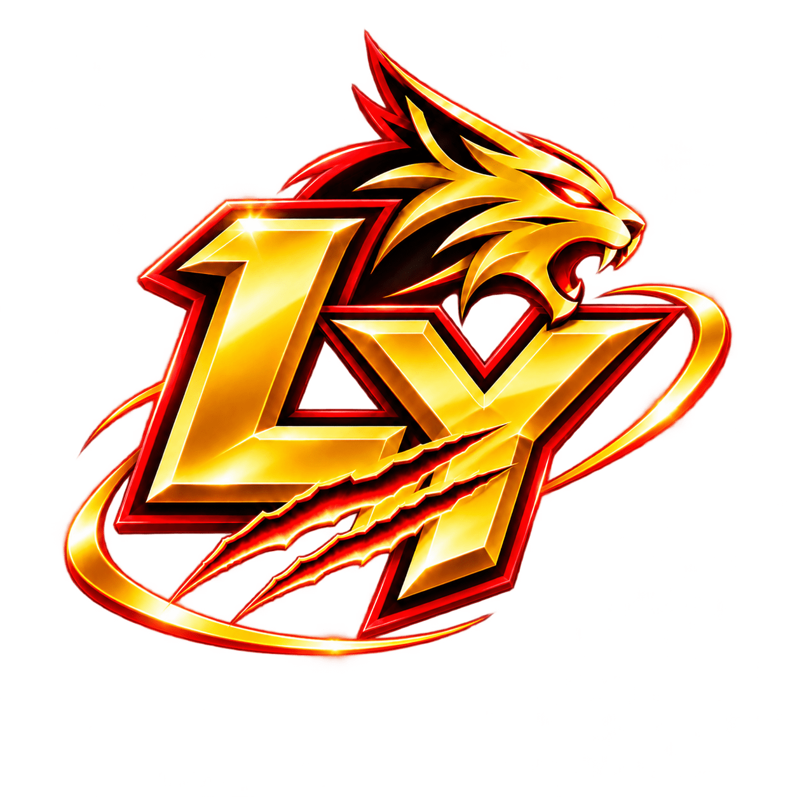

# Lynko Studio

**Carefully crafted software. Connected communities.**

Minecraft plugins, Discord bots and custom software · Born from GoldenLyons, built to go further

<!-- Lynko Discord: replace INVITE with the server invite and uncomment the line below.

-->

---

## 🦁 Where we come from

Lynko Studio grew out of **GoldenLyons Network**, a Minecraft community, and keeps that connection in its identity. You can see it in the `GL-` prefix of every plugin we make.

Our work now goes beyond a single server: we build Discord bots, Minecraft plugins, websites, applications and automation systems for communities, digital projects and teams that need software built for them.

---

## 🛒 What we offer

### ⛏️ Minecraft plugins

Fifteen plugins for **Paper 1.21** (Java 21), free and paid. Each one comes with its own documentation, versions and licence in your dashboard.

| Area | Plugins |
| --- | --- |
| **Economy** | GL-AuctionHouse · GL-Sellwands · GL-Coinflip · GL-Lottery |
| **Community & events** | GL-Clans · GL-Chat · GL-Pinata · GL-JoinActions |
| **Staff & safety** | GL-Staff · GL-InventoryRollback · GL-PrivateChest |
| **World & network** | GL-Teleports · GL-Portals · GL-Elevators · GL-Sync |

### 🤖 Lynko Bot

A modular Discord bot, free to add and configured from the web, server by server:

**Moderation · Tickets · Welcomes · Suggestions · AutoMod · AntiRaid · Logs · Giveaways · Polls · Statistics · Temporary channels · Utilities**

### 👑 Lynko Pro

Our premium plan. One payment, no renewals:

- Six complete Lynko Bot systems on your Discord server.
- Four paid Minecraft plugins of your choice.
- Priority support, early access to betas, a discount on custom projects and the Pro role on our Discord.

### 🧩 Custom development

| Service | What we build |
| --- | --- |
| **Custom software** | Applications and tools that solve a specific problem, with scope, flows and acceptance criteria agreed with you. |
| **Discord bots** | Moderation, support and automation for your community, with clear permissions and settings you can manage. |
| **Minecraft plugins** | Mechanics and systems tailored to your server, starting from your versions, dependencies and needs. |
| **Websites & apps** | From a showcase site to platforms with accounts, dashboards and payments. |

---

## 🧭 How we work

| | Step | |
| :---: | --- | --- |
| **01** | **Understand** | We review your goals, the technical context and what you need to solve. |
| **02** | **Define and build** | We agree on a scope and build in stages, with decisions and progress you can review. |
| **03** | **Deliver and explain** | We test the agreed flows and document the rollout and maintenance. |

Documentation and configuration are part of the product: you should know what each tool does, how to install it and what you need to run it.

---

## 🛠️ Tech stack

**Web & dashboard**

**Bots, plugins & data**

**Infrastructure**

---

## 👥 Team

---

*Born from GoldenLyons. Designed to go further.*

**[lynkostudio.dev](https://lynkostudio.dev)**

